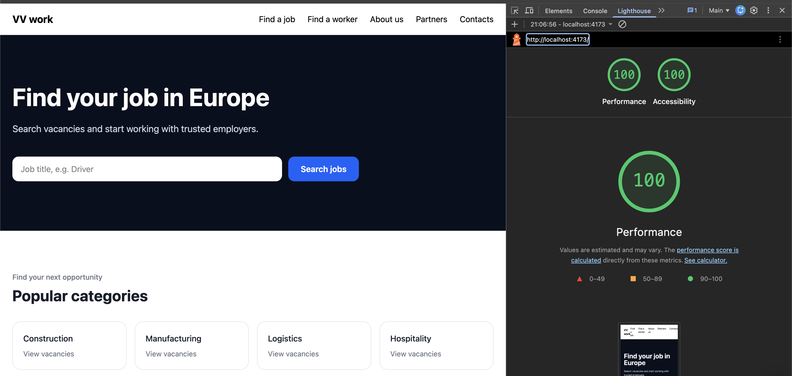

# VV Work website project 

Website Front end project for job search in Europe. Implements vacancies search, application forms, navigations. 

### 1. How to start 
- Clone Github repository:
```cmd
git clone https://github.com/enderavour/intern_vv.git
```
- Navigate to created directory, initialize npm and install dependencies 
```cmd
cd intern_vv
npm install
```
- Run the project
```cmd
npm run dev
```
Afterwards, Vite will start the project and provide the url, e.g. Local: http://localhost:5173/.<br>
Open that address in your browser. 

### 2. Run the tests 
- To run the tests:
```cmd
npm test
```
- To see the test coverage:
```cmd
npm run test:coverage
```

### 3. Architecture design 
The project is built using React, React Router, Vite, Tailwindcss as the technologies. 
The main components of the project are contained in /src/components directory, pages - in /src/pages directory.
All main required pages are implemented:
- AboutPage: Component of /about; currently a placeholder page, which may contain information about the VV Work company.
- ContactsPage: Component of /contacts; contains the form which can be filled if needed to request some message to VV Work team.
- HomePage: main, index page of the project, component of /; contains Job search input field, categories of jobs (which navigate to corresponding vacancies), and employees search, which navigates to Contacts form.
- PartnersPage: Component of /partners/:slug; contains the search field for mock vacancies and overall listing of available vacancies.


For other, not implemented pages implemented component PlaceholderPage, which is reused in PrivacyPage and TermsPage components as plug.

Components:
- ApplicationForm: form for job application; used in PartnersPage.
- ContactsForm: form for messaging company; used in ContactsPage. 
- EmployerCta: form for finding employees for employers; used and located at the bottom of HomePage
- ErrorState: component for indicating errors; used in ContactsPage, applied when vacancies cannot be loaded
- Footer: Footer of the website; contains motto, copyright, links (Company, For you, Follow us), Privacy policy, Terms of use;
- Header: Header of the website; contains company name, and links to different pages (Find a job, Find a worker, About Us, Partners, Contacts);
- LoadSkeleton (and LoadSkeleton.css): Loading skeleton for vacancies while latency happens; 
- PopularCategories: blocked list of categories of available vacancies; Although, all of the blocks lead to generalized category "All";
- ScrollToTop: Null component; used specifically for window scroll up functionality after navigation to each page;

/api directory:
Contains mockFetch.ts file, which implements:
- mockFetch: artificial timeout for vacancy load and 20% chance of returning the error while loading vacancies;
- getVacancies, submitApplication, submitContactForm - wrappers over mockFetch to simulate form sending. 

/constants directory: 
Contains categories listing and regex, used for contacts validation. 

/mocks directory:
Contains mock data of 20 vacancies.

/utils directory:
Contains generalized hooks and callbacks for data validation and debounce. 

### 4. Unit tests

Unit tests are implemented with Vitest and React Testing Library.

There are two subdivisions of testing: components and utils. 
- /components folder contains tests for components (e.g. ApplicationForm, ContactsForm, ErrorState, PartnersPage).
- /utils folder contains tests for Debounce functionality, Fetch functionality, and Validation functionality.

The test suite covers the main application logic and user interactions:

- Debounced search — verifies that the vacancy search value is updated only after the debounce delay and that rapid changes use the latest value.
- Form validation — covers name, phone/Telegram contact, and message length validation, including boundary cases.
- Application form — verifies form rendering, validation errors, successful submission, loading state, and API failure handling.
- Retry flow — verifies that the retry action is triggered when the user clicks the retry button after a failed request.
- Coverage — the project uses Vitest coverage with a minimum target of **60%** for statements, branches, functions, and lines.

The test coverage of the application is higher than 90%. 

### Lighthouse scheenshot



## My decisions
1. Clear homepage structure. Organized the Home page around the two main user journeys: candidates looking for work and employers looking for workers. The Hero section immediately explains the platform's value, followed by popular job categories and a dedicated employer CTA.
2. Posssibility of faster vacancy discovery. The vacancy list supports both title search and category filtering. Search uses a 300ms debounce to avoid unnecessary updates while typing, while category selection is synchronized with the URL so popular categories can link directly to a filtered vacancy list.
3. Simple state management. Used local React state and URL search parameters instead of Redux or Zustand. The application does not have complex global state, so keeping state close to the components that own it makes the code easier to understand and maintain.
4. Controlled rendering of the vacancy list. Filtering is derived with `useMemo`, so the vacancy list is recalculated only when the vacancies, debounced search value, or selected category changes. This avoids unnecessary filtering work on unrelated component updates.
5. Responsive and accessible by default. The layout follows a mobile-first approach and is adapted for 375px, 768px, and desktop widths. Shared Header/Footer components keep the layout consistent across pages, while semantic labels, keyboard-friendly controls, inline validation, and accessibility checks keep the interface usable across different devices and input methods.
